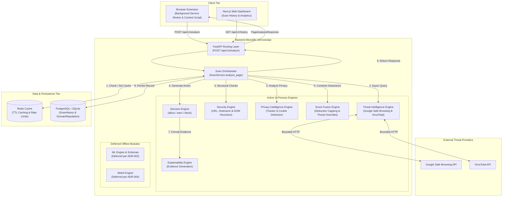

# 03. System Architecture

* **Product:** Site Sentry
* **Architecture Style:** Modular Monolith with Asynchronous I/O
* **Canonical Path:** `dev/03_SYSTEM_ARCHITECTURE.md`
* **Related ADR:** [ADR-003: Retaining FastAPI Modular Monolith Architecture](./decisions/ADR-003-modular-monolith-architecture.md)

---

## 1. High-Level Architecture Overview

Site Sentry is architected as a **FastAPI Modular Monolith** optimized for low-latency, deterministic browser security scanning. Rather than distributing scan execution across microservices or asynchronous message brokers, all active analysis engines execute in-process within `services/api/src/engines/`.

The system comprises three primary tiers:
1. **Client Tier:**
   * **Chrome/Chromium Browser Extension:** Inspects navigation, extracts lightweight structural DOM signals, queries the backend, and displays trusted warning interstitials and popups.
   * **Next.js Management Dashboard:** Allows users and administrators to review scan history and domain reputation analytics.
2. **Platform Core (FastAPI Backend Monolith):**
   * **API Gateway & Routing:** Exposes canonical scan endpoint `POST /api/v1/analyze`, history endpoints, and analytics endpoints.
   * **Scan Orchestrator (`ScanService`):** Orchestrates the synchronous in-process scan pipeline with bounded asynchronous I/O.
   * **Active Engines:** `SecurityEngine`, `ThreatIntelligenceEngine`, `PrivacyIntelligenceEngine`, `ScoreFusionEngine`, `DecisionEngine`, and `ExplainabilityEngine`.
3. **Data & External Integration Tier:**
   * **Redis:** Fast key-value caching (24h domain OSINT cache, 1h full URL analysis cache) and API rate limiting.
   * **PostgreSQL / SQLite:** Relational storage for `ScanHistory` and `DomainReputation`.
   * **External Threat Intelligence APIs:** Google Safe Browsing API v4 and VirusTotal API v3.

---

## 2. Container & Pipeline Diagram

---

## 3. Synchronous Scan Pipeline Flow

The central pipeline executed within `ScanService.analyze_page()` proceeds in strict deterministic order:
1. **Cache Lookup:** Checks Redis for a valid cached `PageAnalysisResponse` for the canonical URL. If found, returns immediately ($< 50\text{ms}$).
2. **Concurrent Threat Intel Query:** Asynchronously fires non-blocking queries to Google Safe Browsing and VirusTotal with a 2.5s individual timeout per [28. Provider Resilience Contract](./28_PROVIDER_RESILIENCE_CONTRACT.md).
3. **Privacy Analysis:** Executes local, in-memory tracker and cookie heuristics.
4. **Security Engine Analysis:** Evaluates deterministic URL syntax, hostname entropy, punycode/homoglyphs, and DOM form targets.
5. **Score Fusion:** Computes proportional deductions (VT deductions capped at 50 pts; structural deductions) and enforces hard threat overrides ($\le 10$ score for confirmed malicious feeds).
6. **Decision Generation:** Evaluates findings and completeness to assign browser actions (`allow`, `warn`, `block`) and classify threat categories (e.g. `inconclusive` under `warn` on incomplete data).
7. **Cache & Persist:** Writes complete results to Redis and records scan telemetry in `ScanHistory`.

---

## 4. Architectural Boundaries: Active vs. Deferred Modules

To maintain high performance and low operational complexity, engines are strictly isolated:
* **Active In-Process Engines:** All engines required for `ScanService` run in-process without network serialization.
* **Deferred Modules (`machine_learning`, `web3`):** Modular code remains in the repository as offline research utilities. They are strictly excluded from the real-time scan pipeline per [ADR-002](./decisions/ADR-002-defer-ml-training.md) and [ADR-004](./decisions/ADR-004-defer-web3-community-intelligence.md).
* **Trust Engine Simplification:** Historical domain reputation is maintained as a database record (`DomainReputation`), but does not act as an opaque second scoring layer overriding current scan evidence.

---

## 5. Related Architecture Documents
* [Backend Architecture](./06_BACKEND_ARCHITECTURE.md)
* [Extension Architecture](./07_EXTENSION_ARCHITECTURE.md)
* [Data Flow Pipeline](./15_DATA_FLOW.md)
* [Security Decision Contract](./27_SECURITY_DECISION_CONTRACT.md)
