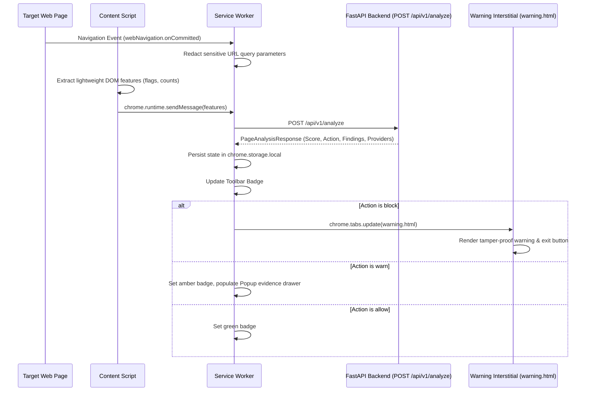

# 07. Browser Extension Architecture

* **Product:** Site Sentry
* **Platform Standard:** Manifest V3 (Chrome, Edge, Brave, Chromium)
* **Canonical Path:** `dev/07_EXTENSION_ARCHITECTURE.md`
* **Related ADR:** [ADR-005: Preferring Explicit Browser Warning Over DOM Tampering](./decisions/ADR-005-browser-warning-over-dom-tampering.md)

---

## 1. Overview

The Site Sentry Browser Extension (`apps/extension/`) is the primary user-facing client. While the backend performs centralized threat intelligence lookups and score fusion, the extension is far from passive. It manages:
1. Navigation event detection and lifecycle management.
2. Client-side URL token sanitization (redacting sensitive query keys before transmission).
3. Minimal DOM structural feature extraction.
4. Tab state persistence across Manifest V3 service-worker wake/sleep cycles.
5. Delivery of trusted, tamper-proof security warnings and evidence dialogs.

---

## 2. Core Extension Subsystems

### 2.1. Content Script (`apps/extension/src/content/`)
* **Execution Boundary:** Injected into target web pages, executing within Chrome's isolated world.
* **Extraction Responsibilities:**
  * Collects minimal structural flags: `has_password_field`, `num_forms`, `num_scripts`, `has_login_form`, `external_form_action`.
  * Computes relative DOM ratios (e.g., external vs. internal link counts).
  * **Strict Data Minimization:** Does **never** capture, inspect, or transmit user-typed passwords, form input contents, session cookies, or raw HTML source per [31. Data Privacy and Retention](./31_DATA_PRIVACY_AND_RETENTION.md).
* **Zero DOM Tampering Policy:** The content script does **not** inject code to disable password fields or rewrite form targets per [ADR-005](./decisions/ADR-005-browser-warning-over-dom-tampering.md).

### 2.2. Background Service Worker (`apps/extension/src/background/`)
* **Navigation Listener:** Listens for `chrome.webNavigation.onCommitted` and `onCompleted` events.
* **Sensitive Query Sanitization:** Strips high-risk query tokens (`token`, `auth`, `password`, `key`, `code`) before network dispatch.
* **Backend Communication:** Sends scan requests to `POST /api/v1/analyze`.
* **State Persistence:** Caches tab analysis records in `chrome.storage.local` to maintain scan state across ephemeral service worker terminations.
* **Toolbar Badging:** Dynamically sets badge color and text based on the decision response:
  * Emerald (`SAFE`): `action = "allow"` (`ui.color = "emerald"`)
  * Amber (`WARN` / `?`): `action = "warn"` (`ui.color = "amber"` for suspicious findings or `threat_category = "inconclusive"`)
  * Rose (`BLOCK`): `action = "block"` (`ui.color = "rose"`)
  * Slate (`OFFLINE`): Client-side operational failure when backend is unreachable (`ui.color = "slate"`)

### 2.3. User Warning & UI Surfaces
* **Full-Tab Interstitial Warning (`pages/warning.html`):**
  * For confirmed malicious sites (`action == "block"`), the service worker redirects the active tab to `chrome-extension://.../pages/warning.html`.
  * Renders in an isolated extension origin that cannot be styled, suppressed, or hijacked by the destination website.
  * Details the exact threat intelligence source and structural red flags with a prominent "Take me back to safety" button.
* **Extension Popup (`src/popup/`):**
  * Opens when the user clicks the toolbar icon.
  * Displays the overall security verdict, score (0–100), provider statuses, and itemized evidence findings.

---

## 3. Communication & Sequence Flow

---

## 4. Resilience and Offline Operation

* If the backend is unreachable or returns a network error, the service worker sets a client-side offline indicator (`slate` color / operational error) and displays a retry button in the popup.
* If external threat intelligence providers time out upstream, the API returns `action = "warn"` with `threat_category = "inconclusive"`, and the extension displays a cautionary amber status honestly explaining to the user that threat feeds could not be reached, rather than giving a false "Safe" rating.
