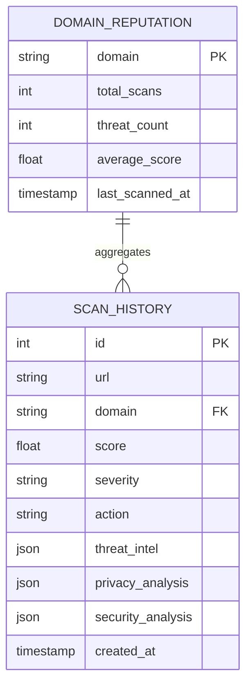

# 13. Database Design

* **Product:** Site Sentry
* **Database Engine:** PostgreSQL 15+ (Production), SQLite (Testing)
* **ORM:** SQLAlchemy 2.0
* **Canonical Path:** `dev/13_DATABASE_DESIGN.md`
* **Implementation:** `services/api/src/models/scan.py`

---

## 1. Overview & Data Minimization Principles

Site Sentry uses PostgreSQL for persistent storage of scan audit histories and aggregate domain telemetry, paired with Redis for sub-millisecond caching and rate limiting.

In strict accordance with [31. Data Privacy and Retention Specification](./31_DATA_PRIVACY_AND_RETENTION.md), the database stores **only security-relevant telemetry**. It explicitly does **not** store user passwords, form contents, browsing session histories, or persistent user tracking cookies.

---

## 2. Entity Relationship Diagram (ERD)

---

## 3. Authoritative Table Definitions

### 3.1. `scan_history` (`services/api/src/models/scan.py`)
Stores the complete audit trail for each executed scan, powering the Next.js Dashboard history view and retrospective threat analysis.

| Column | Type | Constraints | Description |
| :--- | :--- | :--- | :--- |
| `id` | Integer | Primary Key, Auto-increment | Unique scan record identifier. |
| `url` | String(2048) | Not Null, Indexed | Canonical target URL (with sensitive query tokens redacted). |
| `domain` | String(255) | Not Null, Indexed | Fully qualified domain name (FQDN). |
| `score` | Float | Not Null | Final fused security score ($0.0 - 100.0$). |
| `severity` | String(50) | Not Null | Assessment severity (`low`, `medium`, `high`, `critical`). |
| `action` / `verdict` | String(50) | Not Null | Recommended browser action (`allow`, `warn`, `block`). Incomplete analysis is recorded via `threat_category = "inconclusive"`. |
| `threat_intel` | JSON / JSONB | Nullable | Serialized provider results (GSB matches, VT counters, statuses). |
| `privacy_analysis` | JSON / JSONB | Nullable | Serialized tracker and cookie counts. |
| `security_analysis`| JSON / JSONB | Nullable | Serialized structural findings and evidence list. |
| `created_at` | DateTime | Not Null, Default UTC | Timestamp of scan execution. |

* **Indexes:**
  * `ix_scan_history_domain` on `domain`
  * `ix_scan_history_url` on `url`
  * `ix_scan_history_created_at` on `created_at`

### 3.2. `domain_reputation` (`services/api/src/models/scan.py`)
Maintains rolling statistical telemetry for domains evaluated by Site Sentry.

| Column | Type | Constraints | Description |
| :--- | :--- | :--- | :--- |
| `domain` | String(255) | Primary Key | Canonical domain name. |
| `total_scans` | Integer | Not Null, Default 1 | Cumulative number of times this domain has been analyzed. |
| `threat_count` | Integer | Not Null, Default 0 | Number of times this domain yielded a confirmed threat. |
| `average_score` | Float | Not Null | Rolling mathematical average of security scores. |
| `last_scanned_at` | DateTime | Not Null, Default UTC | Timestamp of most recent scan. |

---

## 4. Redis Schema & Key Conventions

Redis acts as the high-speed cache layer to enforce sub-50ms repeat lookups and protect external API rate limits:

* **URL Scan Cache:**
  * `Key:` `sitesentry:cache:url:{sha256(canonical_url)}`
  * `Value:` Serialized `PageAnalysisResponse` JSON
  * `TTL:` 24 Hours (`86400s`) for clean scans; 6 Hours (`21600s`) for confirmed threats.
* **Provider Rate Limit Cooldown:**
  * `Key:` `sitesentry:ratelimit:provider:{provider_name}`
  * `Value:` Active cooldown flag when an upstream HTTP 429 is encountered.
  * `TTL:` 60 Seconds.
* **Client IP Rate Limiting:**
  * `Key:` `sitesentry:ratelimit:client:{ip_address}`
  * `Value:` Token bucket counter.
  * `TTL:` Rolling 60-second window.
